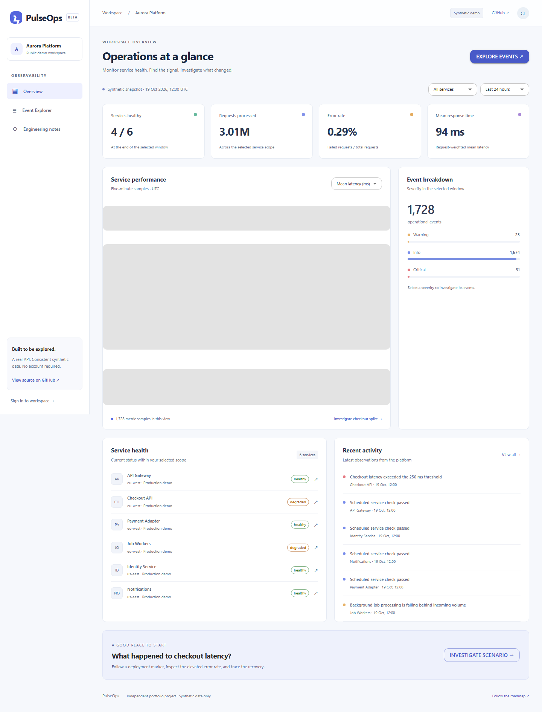

# PulseOps

**An ongoing full-stack operations portfolio by Charles Lin.** Explore service health, investigate operational events, and follow the evidence through an interactive public demo—no account required.

[Live demo](https://pulseops-nine.vercel.app) · [Architecture](ARCHITECTURE.md) · [Roadmap](ROADMAP.md) · [Release scope](docs/RECRUITER-MVP.md)



## Try it in 30 seconds

1. Open the Dashboard and inspect the six services.
2. Choose **Investigate checkout spike** to find the critical events.
3. Open an event, inspect its trace identifier, then search or filter further.
4. Change time range or service to see how operational metrics respond.

## What works today

- Public Dashboard with operational health, request volume, error rate, latency trends, severity distribution and recent activity.
- Event Explorer with search, service/severity/region/date filters, timestamp sorting, 50-row pagination and details.
- URL-backed investigation state, loading/retry/empty states and responsive navigation.
- Real Go REST API and PostgreSQL persistence. Six synthetic services, 1,728 events and matching five-minute metric samples.
- Preserved private workspace: bcrypt passwords, opaque HttpOnly cookie sessions, CSRF origin validation, server role checks and organisation-scoped SQL.
- Go/Postgres integration tests, React tests, Playwright browser checks and GitHub Actions.

## Stack

React 19 · TypeScript · Vite · Material UI · TanStack Query · React Router · Apache ECharts · Go · chi/net/http · pgx · PostgreSQL · Docker Compose · Vercel Functions · Neon

## Local setup

Prerequisites: Docker with Compose. Copy `.env.example` to `.env`, then fill in fresh independent passwords. POSTGRES_PASSWORD must be URL-safe hexadecimal; SEED_PASSWORD must be 12–72 bytes. Never reuse existing service or employer credentials.

```sh
docker compose up --build -d
```

Open http://localhost:5173. The public demo seeds automatically and needs no login.

To exercise the optional private workspace locally:

```sh
docker compose --profile tools run --rm seed
```

Sign in as `alex@aurora.example` or `sam@harbour.example` using your local SEED_PASSWORD. These represent separate organisations. Seed commands are idempotent; changing the environment password does not reset an existing account.

For native development, use Go 1.25+, Node 24 and PostgreSQL. Set DATABASE_URL, APP_ORIGIN=http://localhost:5173 and COOKIE_SECURE=false in the backend shell, then:

```sh
cd backend
go run ./cmd/pulseops migrate
go run ./cmd/pulseops seed-demo
go run ./cmd/pulseops
```

In another terminal:

```sh
cd frontend
npm ci
npm run dev
```

Do not double-click index.html: Vite must serve and compile the application.

## Tests

```sh
cd backend
go test -v ./...
go vet ./...
cd ../frontend
npm ci
npm run lint
npm run format:check
npm test
npm run build
npx playwright install chromium
npx playwright test
```

Set TEST_DATABASE_URL to a dedicated disposable database for Go integration tests. Browser tests use BASE_URL or http://127.0.0.1:5174 and require a running frontend/API/database. CI provisions these automatically. Never run integration fixtures against a shared production database.

## Deployment and honest limitations

[Vercel setup](docs/DEPLOYMENT.md) retains the Go backend and a dedicated Postgres database. Hosted public data is synthetic and read-only; no shared login credentials are exposed. The snapshot is fixed, not a live monitoring feed.

The first release deliberately uses a small JSON dataset stored in Postgres, with filtering in Go. SQL filtering, richer datasets, chart brushing, virtualised tables and incident workflows are upcoming milestones, not claimed current features. Public read routes never access private user/session tables. Login abuse controls, separate database roles and full screen-reader auditing remain hardening work.

## Independence

All implementation and demonstration data are original. No proprietary employer source, assets, credentials or configuration are included. `.env` files, build outputs and dependencies are excluded from Git.
